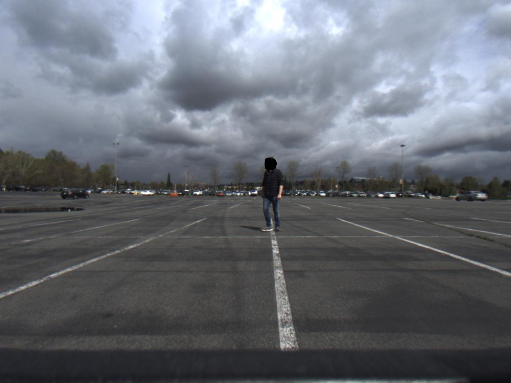
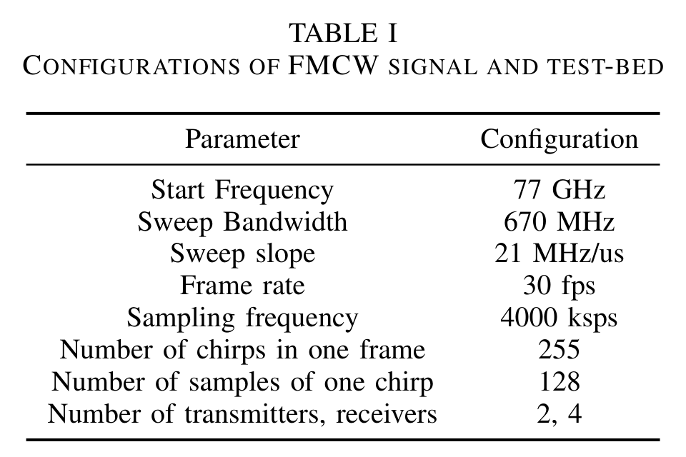

# Real ADC example and provenance

`pms1000_frame000.npz` contains the first frame (Python index 0) of the public `pms1000_30fs.mat` file.
The original file comes from Xiangyu Gao et al.'s [mmWave radar signal processing repository](https://github.com/Xiangyu-Gao/mmWave-radar-signal-processing-and-microDoppler-classification), accompanying [Experiments with mmWave Automotive Radar Test-bed](https://arxiv.org/abs/1912.12566).

These are **real radar I/Q measurements**, not plotted results or generated point clouds. The approximately 632 KB first-frame subset and 2.3 MB STFT sequence both work offline.

## Scene photograph

<p>
  
</p>

The upstream repository supplies [`pms1000.jpg`](https://github.com/Xiangyu-Gao/mmWave-radar-signal-processing-and-microDoppler-classification/blob/c49a101b8ffe75f79abfa75b46b926c8592c7e48/template%20data/pms1000.jpg)
alongside `pms1000_30fs.mat`. This same-name photograph shows a person in a parking lot.
The original MATLAB file contains only the `data_frames` radar array; the photograph is a separate file.
No frame-index or timestamp mapping is supplied between this photo and the extracted frame 0, so the photo provides scene context rather than synchronized ground truth.
The board and car-roof photos in the tutorial illustrate the acquisition platform.

This 980,292-byte image is copied unchanged from the same pinned commit as the radar data, under the upstream [MIT license](LICENSE.upstream.txt).
Its Git blob SHA-1 is `8f7f998d98b9e250e2143a4f731fae0745696e8c`.

## The board in the paper: AWR1642BOOST

The paper's red **AWR1642BOOST** is TI's evaluation board for the **AWR1642** radar chip, with PCB antennas and development interfaces.
The chip supports **76–81 GHz**, **2 TX**, and **4 RX**, and integrates a **C674x DSP** for radar processing and an **Arm Cortex-R4F MCU** for application/control software.
See the [TI board overview](https://www.ti.com/tool/AWR1642BOOST) and [chip documentation](https://www.ti.com/product/AWR1642).

The green **DCA1000EVM** captures raw ADC data from the radar over LVDS and streams it to a PC over Ethernet.
See [TI's capture-board overview](https://www.ti.com/tool/DCA1000EVM).
The [real-data tutorial](../../lab7_mmwave_real_data.ipynb) introduces both boards alongside the photo and traces the signal path to the recorded I/Q array.
The **255 loops** and **128 samples** are recording settings, while **2 TX** and **4 RX** describe the AWR1642's radio channels.

## Contents

| Item | Value |
|---|---|
| Upstream file | `template data/pms1000_30fs.mat`, 16,832,765 bytes, 30 frames |
| Pinned commit | `c49a101b8ffe75f79abfa75b46b926c8592c7e48` |
| MATLAB variable | `data_frames`, `[4, 1958400]`, complex128 |
| Local NPZ | `adc`, `[255, 2, 4, 128]`, complex64; also includes `frame_index=0` |
| STFT NPZ | `pms1000_tx0_rx0_30frames.npz`: `adc`, `[30, 255, 128]`, complex64, plus `frame_indices=0..29` |
| Scene photo | `pms1000.jpg`, same-name upstream photograph; no frame synchronization supplied |
| Axes | `[loop, TX, RX, ADC sample]` |
| Carrier / sample rate / slope | 77 GHz / 4 MS/s / 21.0017 MHz/µs |
| Same-TX slow-time interval | 120 µs, matching the upstream Doppler coordinates |

Extraction only selects a frame, rearranges axes, and converts the dtype without loss, preserving all complex antenna data.
The original I/Q values are exactly representable in complex64; the script checks this sample by sample.
No FFT, denoising, amplitude normalization, or phase calibration is applied. Sources, configuration, and SHA-256 hashes are recorded in [metadata.json](metadata.json).

## STFT sequence: TX0/RX0 across all frames

`pms1000_tx0_rx0_30frames.npz` selects TX0 and RX0 from each of the 30 original frames, preserving axes
`[frame, loop, ADC sample]` and shape `[30, 255, 128]`. It is 2,299,496 bytes, approximately 2.3 MB.
These are raw complex ADC values, with a checked lossless conversion to complex64; the tutorial computes all Range FFT and STFT results itself.
The original first-frame array is unchanged: `sequence[0]` equals `adc[:, 0, 0, :]` from `pms1000_frame000.npz`.

The `stft_sequence` entry in [metadata.json](metadata.json) records channel selection, frame indices, payload SHA-256, and timing assumptions.
The paper's Table I reports 30 fps, but the MATLAB file supplies no frame timestamps.
The tutorial places frame starts at nominal `frame_index / 30` seconds and uses 120 µs between same-TX chirps inside a frame.
STFT windows never cross frame boundaries; the code does not assume a continuous phase relationship across frames or close any frame gaps.

The STFT lesson compares 64- and 128-chirp Hann windows with a 16-chirp hop and 512-point FFT.
It averages power over a fixed range gate after each windowed FFT, using one shared reference across time and window choices.
Gray plot intervals have no evaluated full-window centers. They do not represent zero measured signal power.

## Published FMCW configuration

<p>
  
</p>

Source: [Gao et al., Table I](https://arxiv.org/html/1912.12566v4#S5.T1); see [image credits](../../assets/README.md).
The published table uses rounded values; the exact processing parameters are retained in [metadata.json](metadata.json).
Its **255 chirps** entry corresponds to **255 chirps per TX** in the bundled two-TX layout: **255 loops × 2 TX = 510 transmitted chirps**.
The axis interpretation below follows the upstream processing code.

## What do the four dimensions mean?

The shape `[255, 2, 4, 128]` describes **one recorded frame** with axes
`[loop, TX, RX, ADC sample]`. A frame groups repeated chirps for processing.
A **chirp** is one transmitted frequency sweep.

| Dimension | Meaning in this recording |
|---|---|
| **255 loops** | The two-TX transmit sequence repeats 255 times within the frame. Each loop contains one chirp from TX0 and one from TX1. |
| **2 TX** | Two transmit antenna channels. TX0 and TX1 transmit in alternating chirps, rather than simultaneously. |
| **4 RX** | Four receive antenna channels record the echo simultaneously during each transmitted chirp. |
| **128 samples** | Each RX records 128 complex ADC values within each chirp. Each value contains both I and Q: `I + 1j*Q`. |

```text
One frame
  loop 0:    TX0 chirp -> TX1 chirp
  loop 1:    TX0 chirp -> TX1 chirp
  ...
  loop 254:  TX0 chirp -> TX1 chirp

During each transmitted chirp, all four RX channels record:
  RX0: [sample 0, sample 1, ..., sample 127]
  RX1: [sample 0, sample 1, ..., sample 127]
  RX2: [sample 0, sample 1, ..., sample 127]
  RX3: [sample 0, sample 1, ..., sample 127]
         Each sample is a complex I/Q value.
```

There are **255 × 2 = 510 transmitted chirps** and
**255 × 2 × 4 × 128 = 261,120 complex samples** in this frame.
The RX count does not multiply the number of transmitted chirps: the receivers observe the same transmission in parallel.
I and Q are the two components of each sample, not additional samples or another array axis.

With Python's zero-based indexing, `adc[10, 1, 2, 50]` means:
the **11th loop**, the chirp transmitted by **TX1**, the echo on **RX2**, and the **51st ADC sample**.
Here TX0/TX1 and RX0–RX3 are zero-based channel labels.

Selecting `adc[:, 0, :, :]` keeps TX0 and removes the TX axis, leaving
`[255 chirps, 4 RX, 128 samples]`. There is one TX0 chirp per loop:

| Remaining axis | What varies | Spectrum |
|---|---|---|
| 2: 128 samples | Fast time within one chirp | Range Spectrum |
| 0: 255 loops | Slow time across repeated chirps from TX0 | Doppler Spectrum |
| 1: 4 RX | Receiver position, using complex values at one range–Doppler cell | Angular Spectrum |

### Why this reshape?

The upstream [`generate_ra_3dfft.m`](https://github.com/Xiangyu-Gao/mmWave-radar-signal-processing-and-microDoppler-classification/blob/c49a101b8ffe75f79abfa75b46b926c8592c7e48/generate_ra_3dfft.m) takes 128 consecutive columns per transmitted chirp, then separates odd and even chirps.
For the first frame, the equivalent NumPy operation is:

```python
frame = data_frames[:, :255 * 2 * 128]
adc = frame.reshape(4, 255, 2, 128).transpose(1, 2, 0, 3)
# Original column (2*m + tx)*128 + n maps to adc[m, tx, rx, n].
```

This reshape is specific to the acquisition format; it is not a universal recipe for `.mat` files.

### Parameters and limitations

Numerical parameters come from [`get_params_value.m`](https://github.com/Xiangyu-Gao/mmWave-radar-signal-processing-and-microDoppler-classification/blob/c49a101b8ffe75f79abfa75b46b926c8592c7e48/config/get_params_value.m).
Its `Tc=120e-6` is used for the Doppler sequence **after separating the TX channels**, consistent with the paper's approximately 0.065 m/s velocity resolution. Do not multiply it by the TX count again.

The [real-data notebook](../../lab7_mmwave_real_data.ipynb) uses only the four RX channels associated with TX index 0, following the upstream half-wavelength uniform linear array convention.
It does not concatenate channels across TXs, so TDM motion-phase compensation is not needed.
This small sample has no independent range, velocity, or angle ground truth and no supplied phase calibration. Plotted peaks are algorithm outputs, not labeled accuracy measurements.
The physical meanings of velocity signs and left/right angles are not independently verified in this subset.
The paper describes an AWR1642, while comments in the upstream processing script mention an AWR1843. The tutorial therefore calls these TI 77 GHz measurements without asserting an unverified board revision.

## Download and rebuild

Run from `Lab-7-mmWave/`:

```bash
python prepare_data.py
# Or use an existing download; its SHA-256 is still checked
python prepare_data.py --source /path/to/pms1000_30fs.mat
```

The script downloads the original file from the pinned commit, verifies its SHA-256, rebuilds both the first-frame and 30-frame TX0/RX0 subsets, and prints their ADC payload hashes.
NPZ container bytes may vary with the compressor; compare the decompressed array to establish scientific data equivalence.
The full 30-frame `.mat` file is git-ignored. Class exercises do not require a network connection or another download.

## Attribution and license

The upstream repository distributes its code and accompanying materials under MIT. Its complete [LICENSE](LICENSE.upstream.txt) is retained here. Citation:

Gao, X., Xing, G., Roy, S., & Liu, H. (2019). *Experiments with mmWave Automotive Radar Test-bed*. 2019 53rd Asilomar Conference on Signals, Systems, and Computers, 1–6. DOI: [10.1109/IEEECONF44664.2019.9048939](https://doi.org/10.1109/IEEECONF44664.2019.9048939).
